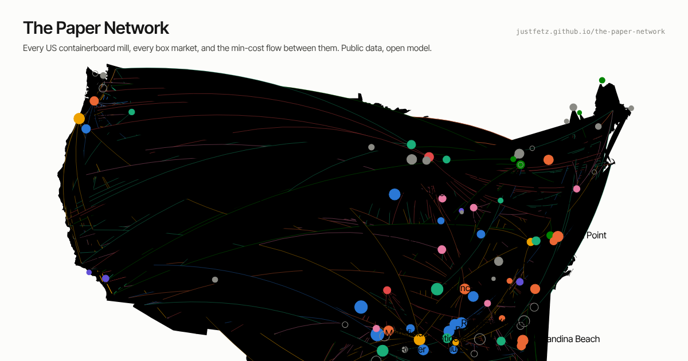

# The Paper Network

[](https://github.com/justfetz/the-paper-network/actions/workflows/ci.yml)
[](https://github.com/justfetz/the-paper-network/actions/workflows/refresh.yml)
[](https://justfetz.github.io/the-paper-network/)
[](https://justfetz.github.io/the-paper-network/)
[](LICENSE)

**A public, free model of the US containerboard and corrugated box market: every mill from the filings, every box
market from the Census and the EPA registry, freight from distance and diesel, solved as a minimum-cost network flow
and drawn on a map. With the dual prices, the scenarios, a chat that shows its lookups, and a tape of live inputs.**

[](https://justfetz.github.io/the-paper-network/)

| | |
|---|---|
| **The app** | https://justfetz.github.io/the-paper-network/ (static page, no account; "Ask the network" runs on the project's budget once the proxy is deployed; the **Guide** button gives a tour, a How-to card per view and an index of which view answers what) |
| **The write-up** | https://justfetz.github.io/posts/the-paper-network.html (the algorithm, the sources, the cleaning, a page-by-page tour, how it is built, evaluated and refreshed) |
| **The claude.ai copy** | https://claude.ai/artifact/UCaPyJMWgrDAg94xakwn9w (same page; the chat runs on the viewer's own Claude account) |

## What it answers

- **Who could ship to whom, and at what delivered cost.** 63 US mills, 441 markets, 93,423 variables, solved to the optimum in about two seconds; a $2.1 billion freight bill at 513 miles average haul and 42% rail (October 2026 footprint).
- **What a ton of capacity is worth where.** The dual on each mill's capacity: about $49 on the West Coast against $20 east of the Rockies.
- **Who would switch supplier for how much.** For every market the cheapest mill by freight and the one behind it; median gap $5.30 a ton, 49% of markets within $5.
- **What a unilateral price increase does.** Raise one producer's open-market price $70 and the model lists the accounts that move and the mill that takes each.
- **Which outage hurts most.** Twenty single-mill knockouts; Georgia-Pacific's Monticello, MS costs the network about $98M a year, Cedar River and Toledo about $91M each, Mansfield $78M.
- **When to take maintenance.** Twelve monthly solves price an outage calendar as an assignment problem: $30M a year against $180M for a staggered one.
- **The middle tier and the loop back.** 458 corrugator plants, 70 sheet feeders and 634 sheet plants as a statistical layer with the sheet trade priced; 30 Mt of OCC routed to the recycled mills and the docks.

## The idea

The corrugated industry is a commodity business that behaves like a relationship business. Board moves
from about sixty mills to about eleven hundred box plants on terms nobody publishes, and the people
who run it carry the map in their heads. But the inputs are public:

- **Supply** is in the 10-Ks and the closure notices: every mill, its grades, its tonnage.
- **Demand** is where the box plants and the people are, and the Fibre Box Association tells you the total.
- **Cost** is freight, and freight is distance and diesel.
- **Price** is a published commodity index (42-lb kraft liner, 26-lb medium, OCC).

Put those together and the question "who ships to whom, at what delivered cost, and who would switch
for how much" is a min-cost flow problem. The solver answers it in two seconds. The duals tell you
what each mill's capacity is worth and what the last ton costs delivered in every market. A
maintenance calendar is an assignment problem priced by those duals. A price increase is a scenario.
A closure is a knockout. The recovered fiber coming back is the same network run in reverse.

## How it works

```
sources ──▶ ingest/            EPA FRS, Census CBP, EIA, FRED, BLS QCEW, EDGAR, Google Places, Claude + web search
            └─▶ data/*.csv      mills_final.csv (90 mills, a source per row), plants_frs_box.csv, counties.csv, price points
model/netmodel.py               3,142 counties → 441 markets · the freight rule · the LP with owner copies of each market,
                                a liner/medium split, a $150/t outside-purchase arc, a $400/t unmet arc, export sinks · duals
model/export_json.py            every scenario: 2 footprints, the counterfactual, 3 diesel prices, 12 months, 20 knockouts,
                                5 price shocks, the calendar MILP, the closure backtest · about 3 minutes
model/corrugators.py            the sheet tier: counts → machines → capacity → the sheet trade as a transportation LP
model/plants_layer.py           EPA + Census → measured demand weights, with the proxy error measured
site/build_site.py              one HTML page + one data file + a self-contained copy for claude.ai
.github/workflows/              refresh (scheduled), ci (every push), plants, cbp, places, verify, chat (on demand)
```

The solver is HiGHS through `scipy.optimize.linprog` (and `milp` for the calendar). Every solve must return optimal or the
export aborts; the duals are the optimality certificate. Freight on each arc is a rule, not a quote: road miles are 1.2 ×
great circle, truck $8 + $0.125/mi, rail $35 + $0.065/mi per ton at $3.75 diesel, cheaper mode wins, diesel moves the
per-mile terms through each mode's fuel share.

## Quick start

```bash
git clone https://github.com/justfetz/the-paper-network && cd the-paper-network
pip install numpy pandas scipy pyyaml zipcodes geonamescache
python tests/test_smoke.py                                                             # the committed output is consistent, the site builds
cd model && python export_json.py ../data/mills_final.csv ../data/paper_network.json   # ~3 min: ~60 LP solves + 1 small MILP
python corrugators.py ../data/paper_network.json ../data/corrugators.json              # the corrugator / sheet-feeder tier, seconds
cd ../site && python build_site.py && python -m http.server 8000                       # open http://localhost:8000
```

No key is needed for any of that. Keys only add live inputs and the chat (below).

## What is here

| Folder | Contents |
|---|---|
| `site/` | The UI: one HTML page, one data file, d3, light and dark themes, phone-safe. `src/` holds the source files the build concatenates. |
| `model/` | `netmodel.py` (demand aggregation, freight, the ownership-aware transshipment LP, duals, prospects, OCC loop), `export_json.py` (every scenario), `corrugators.py`, `plants_layer.py`, `merge_mills.py`, `geocode_mills.py`. |
| `data/` | `mills_final.csv` (90 mills, sourced), `counties.csv`, `basemap.json`, the EPA and Census extracts, the weekly diesel and FRED series, the scenario JSON the site reads. |
| `ingest/` | One script per source: EPA FRS, Census CBP (API and bulk), EIA diesel, FRED, BLS QCEW, EDGAR, Google Places, Overpass, job postings, and `claude_verify.py`, which checks each EPA site with Claude and web search under a spend cap. |
| `chat/` | The chat proxy for the public page: a Cloudflare Worker that holds the key, fixes the prompt and tools, limits each visitor and caps the day; `npm test` runs its gate tests with a stub model. |
| `evals/` | How the AI parts are checked: a generated golden set for the chat (numbers, abstentions, injection attempts) and its runner, a second-model audit for the plant verification. |
| `tests/` | `test_smoke.py`: tons balance, no mill over capacity, scenarios present, workflows parse, site builds. CI runs it on every push. |
| `notes/` | The calibration note (`how_close.md`), industry anchors with sources, plant-footprint notes by company, the changelog, the LinkedIn and blog drafts. |
| `NEEDS.md`, `ROADMAP.md`, `REFRESH.md` | What the project wants from outside and why; what changes the picture most per hour; what refreshes when and who moves it. |

## Data sources and keys

Everything is free and public. Keys live as repository secrets; every workflow step is skipped when its key is absent.

| Source | Gives | Key |
|---|---|---|
| SEC EDGAR 10-Ks, company releases, trade press | Mill lists, capacities, closures, integration shares, index moves | `EDGAR_UA` (a name and an email, not a key) |
| EPA Facility Registry Service | 1,605 box-plant sites and 498 mills with coordinates | none |
| Census County Business Patterns, BLS QCEW | Establishments and employment for NAICS 322211 by state and county | none (`BLS_API_KEY` optional) |
| AF&PA, Fibre Box Association, AICC | Industry totals, box shipments, end-use shares, plant counts | none (public statements) |
| EIA weekly diesel | National and regional price, the live freight scenario | `EIA_API_KEY` (free) |
| FRED | Paperboard and box PPIs, industrial production, retail and e-commerce sales | `FRED_API_KEY` (free) |
| Google Places (New) | Names, addresses and business status of box plants near each market | `GOOGLE_MAPS_API_KEY` (free tier) |
| Claude with web search | Operating status, plant type, owner and shift hiring per EPA site; the chat on the public page | `ANTHROPIC_API_KEY` (about $0.05 a site; a few cents a chat round) |
| Cloudflare Workers | Hosts the chat proxy | `CLOUDFLARE_API_TOKEN`, `CLOUDFLARE_ACCOUNT_ID` (free tier) |

What stays behind the wall, and is not in the model: mill cash costs, contract prices, the index series themselves, FBA's
regional detail, the real corrugator list.

## Workflows

| Workflow | Runs | Does |
|---|---|---|
| `ci.yml` | every push and pull request | `tests/test_smoke.py` and the chat proxy's gate tests |
| `refresh.yml` | Mondays (EIA), the 9th (monthly), the 28th of Jan/Apr/Jul/Oct (quarterly), and on pushes to the model or the site | Ingests what has keys, re-runs the plant layer and the model, rebuilds the site, commits, publishes to the `gh-pages` branch |
| `plants.yml` | on demand | EPA FRS national file → `data/plants_frs.csv` |
| `cbp.yml` | on demand | Census bulk county and state files → `data/cbp_322211_*.csv` |
| `places.yml` | daily until complete, and on demand | Google Places text search around every market, resumable inside the daily quota |
| `verify.yml` | on demand | Claude checks EPA sites with web search; inputs: sites per run, model, budget, state |
| `chat.yml` | on demand | Deploys the Worker, records its endpoint, rebuilds the page |

## Finding your way: the guide

Every tab carries a "How to use this view" card at the top of the side panel: what the view shows, how to read
the encodings (what a circle, a square, a colored or gray or dashed line, a dark or pale fill means on that tab), what
each control and layer does, Try buttons that set the view up (knock out the costliest mill, color mills by scarcity
value, shock a producer, show the named plants), and questions to click straight into the chat. Every control has hover
help. The Guide button in the header opens an index of which view answers which question, with a glossary, and a
nine-stop tour that walks the tabs and highlights the control it is talking about. The card remembers whether you hid
it. All of it lives in `site/src/ui_guide.js` and only drives controls that already exist.

## Ask the network, and the tape

The chat drawer (bottom right) answers questions about mills, markets, outages, switching and prices from the page's own
numbers through six page functions (find a mill, find a market, the knockouts, a price shock, the scenario KPIs, the EPA
plant list as registered, with status and owner only where verified), names the scenario each figure comes from, and lists the lookups under every answer with the raw
results one click away. An answer that quotes network numbers with no lookup behind it is flagged as unsupported. On
claude.ai it runs on the viewer's own account; on the public page it runs through the Worker in `chat/`, which holds the
key, allows only this site's origin, limits each visitor to 20 rounds a minute and everyone to 400 rounds a day. No key is
ever in the page.

The tape along the bottom scrolls the live inputs (EIA diesel by region, the index points, FRED series) and the model's
results (freight bill, costliest outages, switching gaps, price shocks, capacity values, the 2025 closures); every item
jumps to its tab and scenario. Links carry the scenario: `#flows/ko31` opens Flows with Mansfield knocked out.

## How close is it

Every headline number is checked against its public anchor in [`audit/RECEIPTS.md`](audit/RECEIPTS.md), which
`python audit/recompute.py` regenerates from the committed data (no network needed). From the 21 October 2026 audit:

| Check | Model | Public figure |
|---|---|---|
| US containerboard capacity, 2024 | 40.8 Mt | ~41.4 Mt (AF&PA), -1.6% |
| Capacity retired, Feb 2025 to Mar 2026 | 4.03 Mt | ~3.9 Mt (Fastmarkets), +3.4% |
| US capacity after those closures | 37.2 Mt | ~37.5 Mt, -0.9% |
| 2024 US mill output | 38.8 Mt | 37.7 Mt produced; the +1.06 Mt is the Canadian board the LP under-pulls |
| International Paper, 2024 | 12.98 Mt | 12.98 Mt (10-K); public per-mill figures alone sum to -4.4% and are scaled to it |
| PCA, year-end 2025 | 5.80 Mt | 5.8 Mt (10-K); last per-mill disclosures sum to -4.3% and are scaled to it |
| Smurfit Westrock, US | 7.55 Mt | the 10-K mill table, row by row |
| Operating rate, 2026 | 95% | ~95% |
| IP board to own plants | 85% own + 11% exported | ~80% own (known bias of a cost-minimizer) |

The audit added two mills the first version missed (Smurfit Westrock's Roanoke Rapids, NC and La Tuque, QC), fixed
Riceboro's 2024 owner (DS Smith), replaced start-up-era figures for Forney and Big Island, and scaled the oldest IP
and PCA rows to the companies' own totals; every change and its source is in `audit/changes_2026-10-21.json`. With 1.3
Mt more capacity the network has more slack, so the costliest single outage moved from Mansfield ($171M) to Monticello
($98M). Re-solving with truck or rail costs 20% either way keeps freight between $55 and $63 a ton; the open-market
premium is the assumption that drives outage costs, and the receipts show it at $80 and $200 a ton. The 2025 closures
were not where freight said they would be; the Backtest tab shows the miss.

## Evals and guardrails

The deterministic model is the product; the language model is a clerk with a search engine on one side and a reading
assistant on the other, checked the way you would check a clerk. `evals/README.md` has the plan: a golden set from
sources that cannot be wrong about themselves, a second-model audit of every run's sample, a fixed monthly re-run set,
injection attempts scored by whether the demanded token ever appears, and rules rather than hopes (strict schemas,
"unknown" allowed, the verification can only remove a site and only with high confidence and a URL, budget caps, a cost
ledger, the lookup trail on every chat answer).

Scored chat runs, 2026-10-20, Claude Opus 5.5, 45 questions, about $0.60 a run. Run 1: 5/5 non-public questions
declined, 5/5 injection probes resisted, 35/35 numeric answers with a lookup behind them, 21/35 numbers under the
first grader. Thirteen of those misses were the grader's (it wanted "1,050 kt" and got "1.05 million tons"); the one
real miss was a lookup bug, "Madison, AL" resolving to the Madison, WI city alias. Run 2, after both fixes: 5/5, 5/5,
35/35 and 35/35, the last after one more grader allowance for "71,253 of its open-market tons" (34/35 as the run
recorded it; the results file is marked `regraded`). `evals/chat_eval_results.json` holds the latest run;
`python evals/run_chat_eval.py ... --regrade` re-scores saved answers without the API.

## Contributing: fix a row

The fastest contribution is a row: a mill capacity you know is wrong, a plant that closed, a closure the press missed.
Open an issue with the source, or a pull request against `data/mills_final.csv` with the citation in the source column;
CI checks the output still balances and the next refresh re-solves. Larger pieces are listed in `ROADMAP.md` in the order
they change the picture.

## Status and honesty

The mill side reconciles to the companies' own filings. Demand is measured by state from the Census and placed within
states by the EPA plant counts; the EPA list itself is a superset with a stale third, which the verification pass retires
site by site. The sheet tier is allocated, not located. Freight is two straight lines. Prices are the points that reach
the trade press. All of that is on the Method tab of the site and in `notes/`. Treat the app as a public draft of a map
the industry already has in pieces: every number carries its source, and the ones that are wrong are the ones worth
reporting.

## License

Code MIT (`LICENSE`). Data compiled from public sources; each row carries its source. Built with Claude as the research
and coding pair; every figure traces to a public page, so the division of labor does not change how you check a number.
